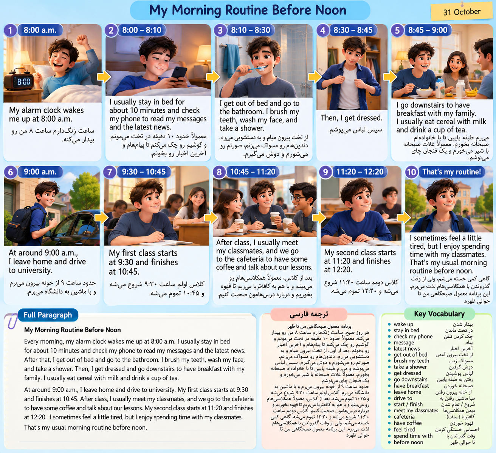

# Writing day one--->about morning routine
----

<p align=center>
	
</p> 
```
Every morning, my alarm clock wakes me up at 8:00 a.m. I usually stay in bed for about 10 minutes and check my phone to read my messages and the latest news.

After that, I get out of bed and go to the bathroom. I brush my teeth, wash my face, and take a shower. Then, I get dressed and go downstairs to have breakfast with my family. I usually eat cereal with milk and drink a cup of tea.

At around 9:00 a.m., I leave home and drive to university. My first class starts at 9:30 and finishes at 10:45. After class, I usually meet my classmates, and we go to the cafeteria to have some coffee and talk about our lessons.

My second class starts at 11:20 and finishes at 12:20. I sometimes feel a little tired, but I enjoy spending time with my classmates.

That's my usual morning routine before noon.
```

